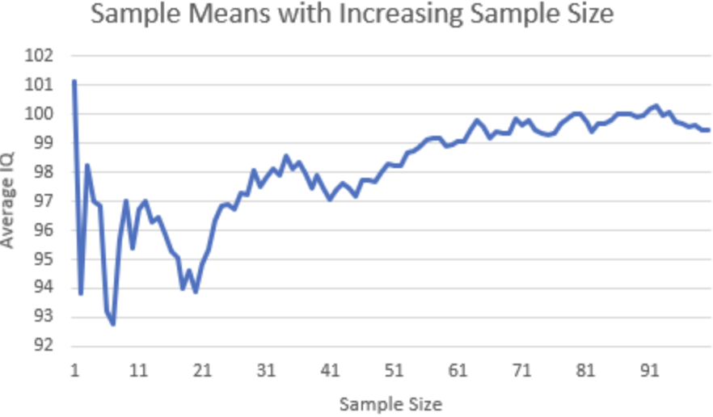

Suppose we flip a fair coin ten times and get eight heads. The observed proportion of heads is now 80%, even though we know the true probability is only 50%.

What happens if we keep flipping?

A common intuition is that tails should now become more likely in order to "balance out" the earlier heads. But that cannot be right. If the coin is fair and each flip is independent, the probability of heads on the next flip is still exactly 50%.

So the more interesting question is:

> **If future flips do not correct the past, why does the sample average become more stable as we collect more data?**

This is the intuition behind the **Law of Large Numbers (LLN)**.

## What Does the Law of Large Numbers Say?

The Law of Large Numbers says that, under appropriate conditions, the sample average gets closer to the expected value as the number of observations becomes large.

If we observe values \(X_1, X_2, ..., X_n\), their sample average is

$$
\bar{X}_n = \frac{1}{n}\sum_{i=1}^{n}X_i.
$$

As \(n\) becomes large,

$$
\bar{X}_n \rightarrow E[X],
$$

where \(E[X]\) is the expected value of the random variable.

For a fair coin, define heads as 1 and tails as 0. Then

$$
E[X] = 0.5.
$$

This means that as we flip the coin many times, the proportion of heads tends to become closer to 0.5.

Importantly, this does **not** mean that the next few flips must be tails.

## Convergence Comes From Dilution, Not Correction

Return to the example where eight of the first ten flips are heads.

Suppose the next 90 flips contain 45 heads and 45 tails. Nothing unusual happened in those 90 flips—the coin simply behaved close to its expected 50% rate.

After 100 total flips, we would have

$$
\frac{8+45}{100}=0.53.
$$

The proportion has already fallen from 80% to 53%, even though the coin never tried to "correct" the earlier outcome.

This happens because the first ten flips become a smaller part of the total sample.

After 10 flips, they represent 100% of the data. After 100 flips, they represent only 10%. After 1,000 flips, they represent only 1%.

The unusual beginning is still there, but its influence becomes smaller and smaller.

This gives a useful way to understand the LLN:

> **Large samples do not erase early randomness. They dilute its effect.**

## Why Does This Matter for Real Data?

This same idea explains why sample averages are so important in economics and data analysis.

Suppose we want to estimate the average wage of workers. If we survey only 20 people, a few unusually high or low earners could change the sample mean substantially. With a much larger sample, each individual observation has less influence, so random variation tends to matter less.

The same logic applies when estimating quantities such as unemployment, household spending, or average income.

However, the Law of Large Numbers does **not** mean that simply collecting more observations automatically gives us the truth.

Imagine surveying 100,000 people about income, but only selecting people from wealthy neighborhoods. The sample mean may be extremely stable, but it can still be a poor estimate of average income for the entire population.

So there are really two different issues:

- **Random variation:** larger samples usually help reduce its influence.
- **Systematic bias:** larger samples do not automatically fix it.

This is an important distinction. More data can make an estimate more precise, but the data still need to represent the population we are trying to study.

## More Data Does Not Mean Perfect Data

Even with a fair coin, a large sample will not usually produce exactly 50% heads.

After thousands of flips, we might observe 49.7% or 50.4%. Randomness is still present. The difference is that very large deviations become less common as the sample grows.

Therefore, the Law of Large Numbers should not be understood as a promise that the data will eventually become perfect. Instead, it explains why averages calculated from sufficiently large and appropriate samples tend to become more stable.

## Takeaway

The Law of Large Numbers is sometimes misunderstood as saying that random outcomes eventually "balance themselves out."

That is not what happens.

Each new coin flip is still independent, and the probability of heads remains 50% regardless of what happened before. The sample average moves toward 50% because early random outcomes receive less and less weight as more observations are added.

For real-world data, the same logic explains why larger samples can produce more stable estimates. But sample size alone is not enough: **more data reduces random noise, not systematic bias**.

A simple way to remember the main idea is:

> **Large numbers do not correct randomness—they dilute its influence.**