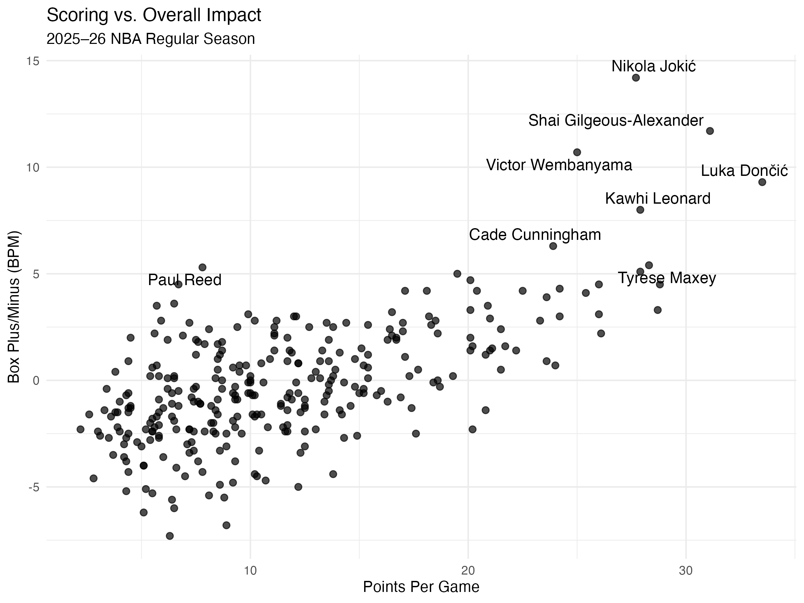
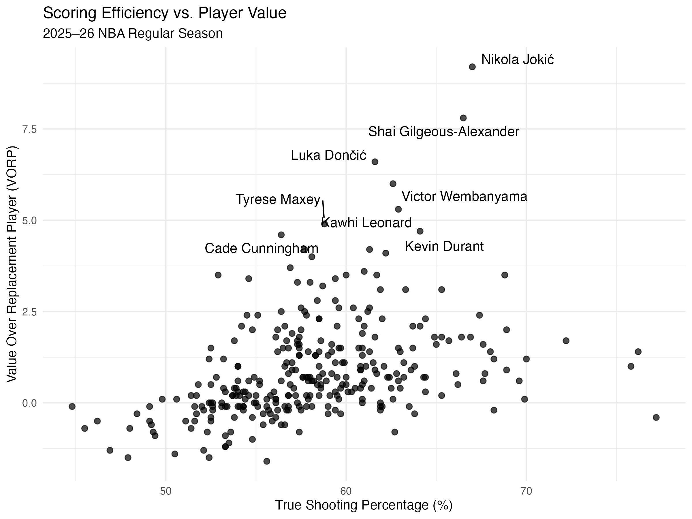
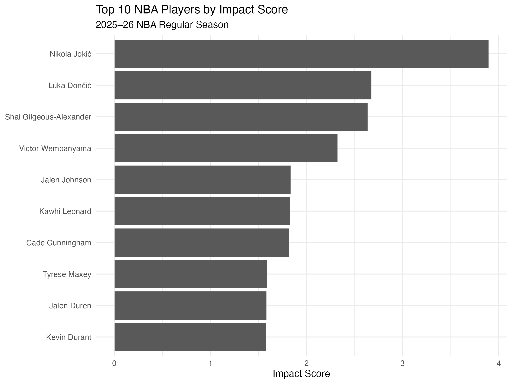

Basketball fans often judge players first and foremost by one statistic: points per game. While scoring is certainly important, it doesn’t fully reflect a player’s contribution. Players can add value through passing, rebounding, efficient shooting, defense, and simply helping their team perform better on the court.

This has sparked my interest in a broader question: Which players had the greatest overall impact during the 2025–26 NBA regular season?

## Data Collection

I used the `rvest` package in R to collect player statistics from the Basketball-Reference website. I scraped two publicly available data tables: one containing traditional per-game statistics and the other containing advanced statistics.

The traditional data includes points per game, rebounds, assists, steals, and blocks. The advanced dataset contains metrics such as True Shooting Percentage (TS%), Box Plus/Minus (BPM), Win Shares, and Value Over Replacement Player (VORP).

To keep the scraping process lightweight, I requested only the two pages of data needed for the analysis and inserted a brief delay between each request. Before performing any data cleaning, I saved the original tables so that I could reproduce the analysis results based on the raw scraped data.

After the scraping was complete, I removed the summary rows, converted relevant variables to numerical formats, handled players who had played for multiple teams, and merged the traditional and advanced data sets. I then limited the sample to players who had appeared in at least 50 games.

## Does More Scoring Mean More Impact?

The first figure compares points per game with BPM, an advanced measure of a player's estimated contribution relative to an average player.

There is clearly a positive relationship: higher-scoring players generally tend to have higher BPM. However, the relationship is far from perfect. Nikola Jokić stands out with the highest BPM even though he was not the league's highest scorer. Shai Gilgeous-Alexander, Luka Dončić, Victor Wembanyama, and Kawhi Leonard also combine high scoring with strong BPM.

This suggests that scoring contains useful information about player quality, but it does not capture the full picture.

## Efficiency Is Not the Same as Total Value

The second figure compares True Shooting Percentage with VORP. TS% measures scoring efficiency while accounting for two-point shots, three-point shots, and free throws. VORP, in contrast, is intended to capture a player's cumulative value relative to a replacement-level player.

Again, the relationship is positive but imperfect. Some players on the far right of the graph have extremely high shooting efficiency but relatively modest VORP. This can happen when a player takes fewer shots or has a smaller offensive role.

The most interesting players are therefore in the upper-right portion of the graph: they combine strong efficiency with high overall value. Jokić is especially notable, while Gilgeous-Alexander, Dončić, Wembanyama, Leonard, and Kevin Durant also perform strongly across these dimensions.

## Building a Simple Impact Score

To compare players across several dimensions at once, I constructed a simple composite **Impact Score**. I standardized six variables—points, rebounds, assists, TS%, BPM, and VORP—using z-scores and then gave each variable equal weight.

This is **not an official NBA statistic**. It is simply a transparent way to combine different types of contribution into one measure.

Based on this evaluation criteria, Nikola Jokić tops the list by a wide margin, followed closely by Luka Dončić and Shai Gilgeous-Alexander. Victor Wembanyama ranks fourth, while Jalen Johnson, Kawhi Leonard, Cade Cunningham, Tyrese Maxey, Jalen Duren, and Kevin Durant round out the top ten.

A key finding is that this ranking does not simply mirror the scoring leaderboard. For example, Dončić ranks first in points per game among the players in this sample, but Jokić ranks higher in the comprehensive metrics due to his exceptional performance across multiple categories.

## Takeaway

The main lesson from this analysis is simple: **points per game are useful, but they should not be used alone to evaluate NBA players.**

Scoring, efficiency, playmaking, rebounding, and advanced impact measures capture different parts of a player's contribution. For fans or analysts comparing players, combining traditional statistics with measures such as BPM, VORP, and TS% provides a more complete picture than relying on scoring alone.

At the same time, any composite ranking depends on how "impact" is defined. My Impact Score gives equal weight to six statistics, and a different weighting scheme could produce a different ranking. The goal is therefore not to create a definitive list of the NBA's best players, but to show how web-scraped data can produce a more nuanced comparison than a single statistic.