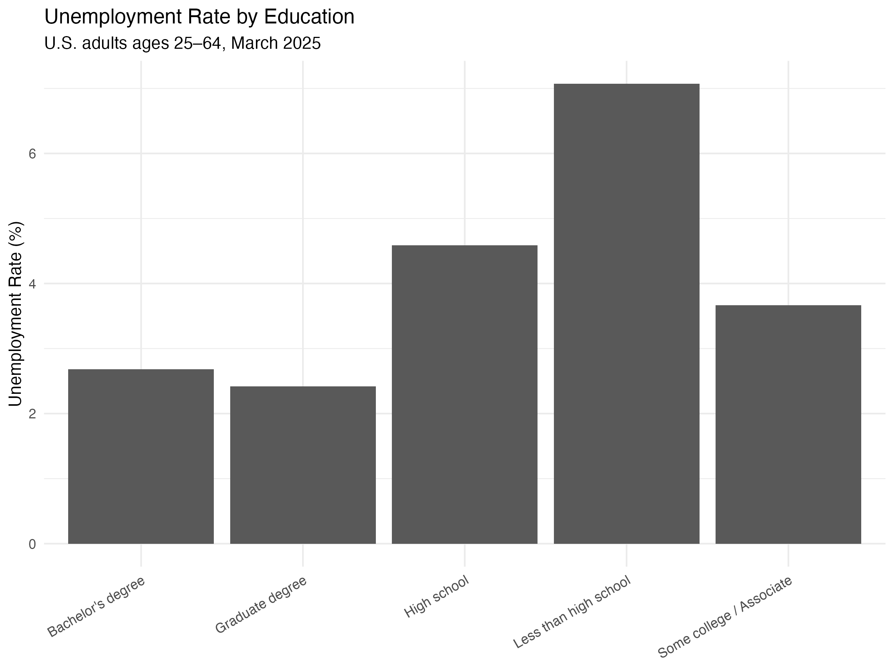
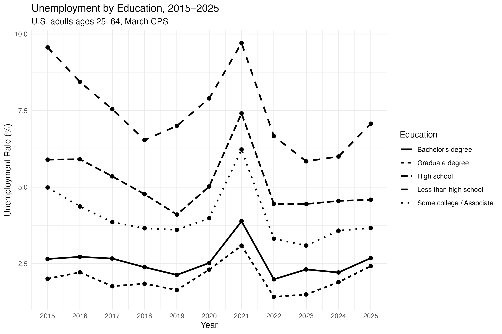
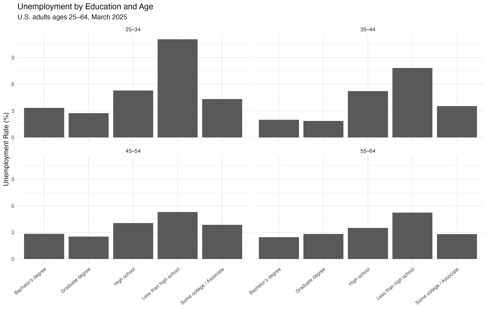

Education is often associated with better labor-market outcomes, but how large is the difference in unemployment across education groups? Does the gap only appear in a single year, or is it persistent over time?

To explore these questions, I use data from the **IPUMS Current Population Survey (CPS)** to compare unemployment rates across educational attainment groups among U.S. adults ages 25–64.

## Data and Method

I use the March Basic Monthly CPS samples from 2015 through 2025. I restrict the sample to adults between ages 25 and 64 who are in the labor force. This age range helps focus the analysis on people who are more likely to have completed their education and are still within their main working years.

I divide educational attainment into five groups:

- Less than high school
- High school
- Some college / Associate degree
- Bachelor's degree
- Graduate degree

Importantly, the CPS is a survey rather than a complete count of the U.S. population. Therefore, I use the CPS final person weight, `WTFINL`, when calculating unemployment rates. This makes the results representative of the population rather than simply describing the observations in the downloaded sample.

The unemployment rate is calculated as the weighted share of labor-force participants who are unemployed.

## Unemployment in 2025

The first figure shows a clear relationship between education and unemployment in March 2025.

Adults with less than a high school education had the highest unemployment rate, at roughly 7%. The rate falls to around 4.5% among high school graduates and around 3.7% among people with some college or an associate degree.

The unemployment rate is lowest among people with bachelor's and graduate degrees, both of which are around 2–3%.

The pattern suggests a clear **education gradient**: higher educational attainment is associated with lower unemployment.

## Has This Pattern Been Stable Over Time?

The chart shows unemployment rates by educational attainment from 2015 to 2025.

This ranking has shown remarkable stability. Almost every year, adults with less than a high school education have had the highest unemployment rates, while those with bachelor’s and graduate degrees have had the lowest.

All educational groups experienced a marked increase in unemployment rates around 2021. However, the rise in unemployment rates was much steeper for workers with lower levels of education. The unemployment rate for those without a high school diploma rose to nearly 10 percent, while the increase for college graduates was much smaller.

## Does Age Explain the Difference?

One possible explanation for the educational gap is that there may also be age differences among people with different educational levels. To explore this, I divided the 2025 sample into four age groups.

In most age groups, the overall trend remains the same. The unemployment rate for those with less than a high school education remains relatively high, while the unemployment rate for those with bachelor’s and graduate degrees is generally lower.

This disparity is particularly pronounced among adults aged 25 to 34. In this group, the unemployment rate for those without a high school diploma exceeds 10 percent, while the unemployment rate for those with a bachelor’s or graduate degree is approximately 3 percent.

This suggests that the overall relationship between educational attainment and unemployment rates is not solely attributable to differences in the age structure of various educational groups.

## Takeaway

Based on these three charts, the conclusion is consistent: **The higher the level of education, the lower the unemployment rate.**

This correlation is evident in the 2025 cross-sectional data, persists throughout the period from 2015 to 2025, and remains pronounced across different age groups.

However, this analysis is purely descriptive and does not prove that higher educational attainment directly leads to lower unemployment rates. Other factors, such as occupation, industry, work experience, and worker characteristics, may also influence these differences. 